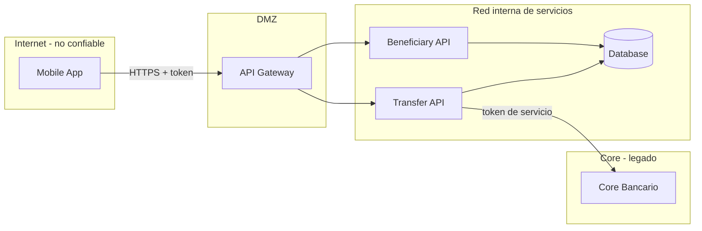

# Arquitectura — Beneficiarios y Transferencias (caso ficticio)

## Necesidad de negocio
"El banco quiere permitir que un cliente registre un beneficiario y posteriormente realice
transferencias hacia ese beneficiario."

## Componentes

| Componente | Responsabilidad | Tecnología |
|---|---|---|
| Mobile App | UI del cliente. Obtiene token del IdP. | iOS / Android |
| API Gateway | Terminación TLS, validación de token, rate limiting, enrutamiento | Gateway corporativo |
| Beneficiary API | Alta, consulta y verificación de beneficiarios | Spring Boot (este repo) |
| Transfer API | Ejecución de transferencias a beneficiarios verificados | Spring Boot (este repo) |
| Database | Clientes, beneficiarios, transferencias | Relacional |
| Core Bancario | Cargo/abono real, saldos | Sistema legado (token de servicio) |
| IdP | Autenticación del cliente, segundo factor | OIDC corporativo |

## Diagrama y límites de confianza

## Flujos
1. **Alta de beneficiario:** App → Gateway → Beneficiary API → DB. Queda `PENDING` hasta segundo factor.
2. **Consulta:** App → Gateway → Beneficiary API → DB (lista y detalle).
3. **Transferencia:** App → Gateway → Transfer API → (valida beneficiario) → DB → Core Bancario.

## Activos
Sesión/token del cliente · datos del beneficiario (RUT, nombre, cuenta) · monto y destino de la
transferencia · token de servicio del Core · registros de auditoría · reputación y cumplimiento.

## Identidades
Cliente final · App móvil (cliente público) · servicios internos · operador de soporte · agente de IA del equipo de desarrollo.

## Supuestos de diseño (NO asumir controles fuera de esta lista)
- El Gateway valida firma y expiración del token.
- No existe todavía control de cuotas por cliente para altas de beneficiarios.
- No está definido el umbral de monto que exige reautenticación.
